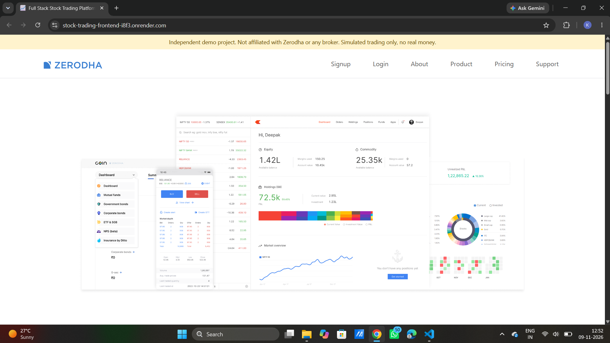
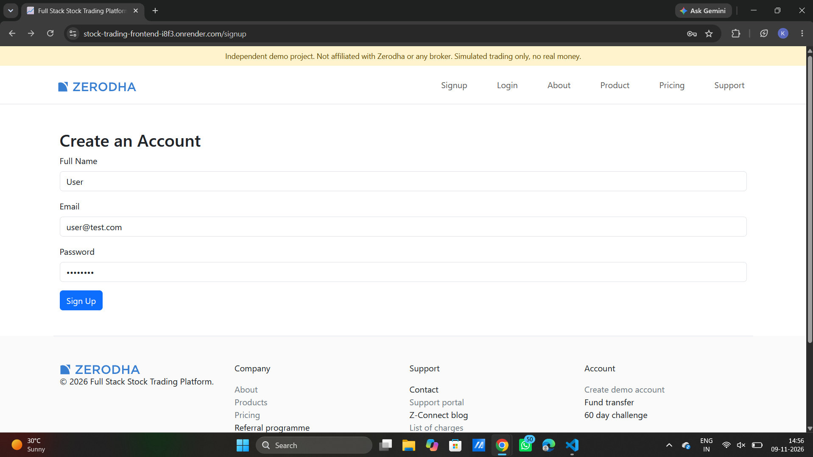
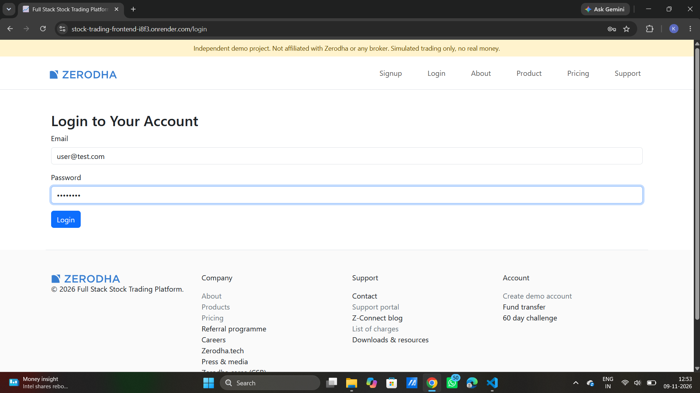
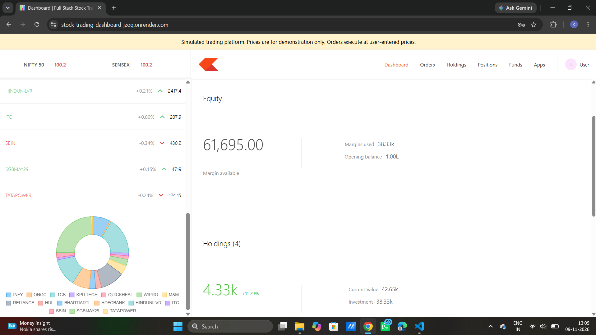
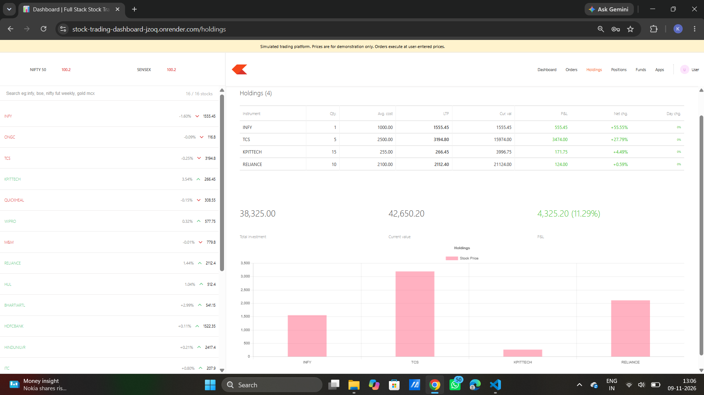
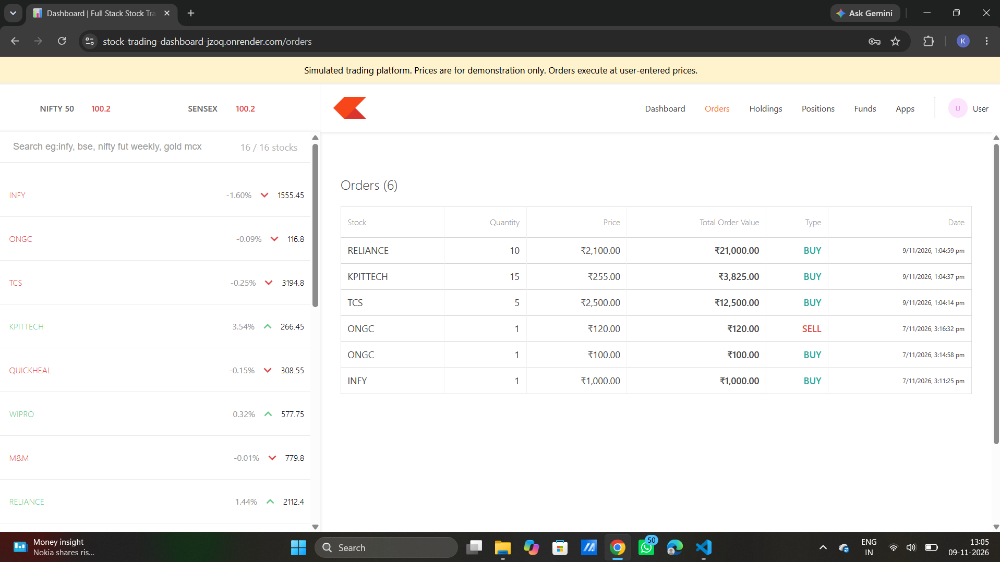
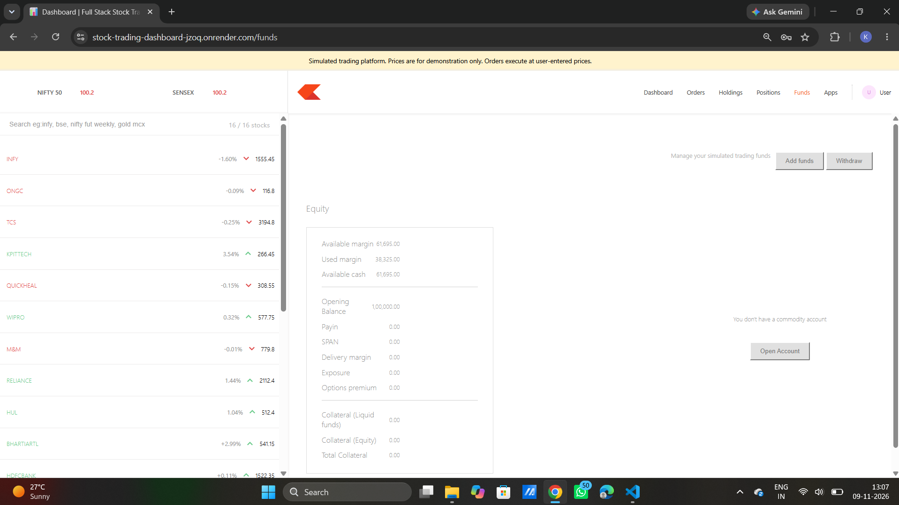

# Full Stack Stock Trading Platform

A full-stack stock trading simulation built with React, Node.js, Express, and MongoDB. The project demonstrates user authentication, portfolio management, and simulated stock buy/sell workflows through a separate landing-page frontend and trading dashboard.

> **Disclaimer:** This is an independent demo project inspired by online stock trading platforms. It is not affiliated with Zerodha or any broker. It does not execute real trades or use live market data.

## Table of Contents

- [Live Demo](#live-demo)
- [Screenshots](#screenshots)
- [Features](#features)
- [Technology Stack](#technology-stack)
- [Project Structure](#project-structure)
- [Application Architecture](#application-architecture)
- [Database Structure](#database-structure)
- [API Endpoints](#api-endpoints)
- [Installation and Local Setup](#installation-and-local-setup)
- [Testing](#testing)
- [Deployment](#deployment)
- [Demo Data and Limitations](#demo-data-and-limitations)
- [Future Improvements](#future-improvements)
- [Author](#author)

## Live Demo

- **Frontend:** [Full Stack Stock Trading Platform](https://stock-trading-frontend-i8f3.onrender.com)
- **Trading Dashboard:** [Dashboard](https://stock-trading-dashboard-jzoq.onrender.com)
- **Backend:** [Backend API](https://stock-trading-backend-s8om.onrender.com)

> **Note:** The backend runs on Render's free tier and sleeps when idle. The first request may take 30 to 60 seconds while the server wakes up.

To try the app, sign up to create a demo account. Every new account starts with a simulated balance of ₹1,00,000.

## Screenshots

### Landing Page


### Signup


### Login


### Trading Dashboard


### Holdings


### Orders


### Funds


## Features

### User Authentication

- Registration with name, email, and password.
- Backend input validation and duplicate email detection.
- Password hashing using bcryptjs.
- JWT-based authentication stored in HTTP-only cookies.
- Session verification when opening the frontend or dashboard.
- Protected dashboard access.
- Logout that clears the authentication cookie.

### Landing Page Frontend

- Home, About, Products, Pricing, and Support pages.
- Signup and login pages.
- Responsive navigation and layouts.
- Disclaimer banner stating this is a simulated-trading project.

### Watchlist

- Predefined list of stocks with demonstration prices and percentage changes.
- Search stocks by name.
- Buy and Sell actions for supported stocks.
- Doughnut chart of watchlist price data.

### Trading Dashboard

- Portfolio summary: available balance, used margin, total investment, current holdings value, and overall profit and loss.
- Holdings table with quantity, average price, current price, and P&L.
- Holdings chart, Positions page, Order history, and Funds overview.
- Profile menu with logout.

### Simulated Buy and Sell Orders

- Place BUY and SELL orders at a user-entered price.
- Validation of stock name, quantity, price, and order type.
- Blocks purchases when funds are insufficient and sales that exceed owned shares.
- Updates the available balance after each successful order.
- Merges repeat purchases into one holding using a weighted average price.
- Removes a holding when all its shares are sold.
- Saves order history in MongoDB.
- Uses MongoDB transactions to keep related updates consistent.

### Funds Management

- Each new user receives an initial simulated balance of ₹1,00,000.
- BUY orders deduct the order value; SELL orders add the sale value.
- Used margin is calculated from holdings using the total average purchase value (average price × quantity).

## Technology Stack

| Area       | Technologies                                                                                    |
|------------|-------------------------------------------------------------------------------------------------|
| Frontend   | React 19, React Router DOM, Axios, Bootstrap 5, Font Awesome                                    |
| Dashboard  | React 18, React Router DOM, Axios, Material UI, Chart.js, react-chartjs-2                       |
| Backend    | Node.js, Express.js, MongoDB, Mongoose, JWT, bcryptjs, cookie-parser, cors, dotenv, body-parser |
| Testing    | Jest, Supertest, React Testing Library, Jest DOM, User Event, MongoDB Memory Server             |
| Deployment | Render, MongoDB Atlas                                                                           |
## Project Structure

```text
Full-Stack-Stock-Trading-Platform/
│
├── backend/
│   ├── data/            # Static stock price data (stockPrices.js)
│   ├── middleware/      # JWT authentication middleware
│   ├── model/           # Mongoose models (Users, Funds, Holdings, Orders, Positions)
│   ├── routes/          # Registration, login, logout and session routes (auth.js)
│   ├── schemas/         # Mongoose schemas for each collection
│   ├── tests/           # Backend tests (auth, funds, holdings, orders, new orders)
│   ├── .env.example     # Example backend environment variables
│   ├── app.js           # Express app and API endpoints
│   ├── index.js         # Backend server entry point
│   └── package.json
│
├── frontend/
│   ├── public/
│   │   └── media/       # Images, logos and static assets
│   │
│   ├── src/
│   │   ├── landing_page/
│   │   │   ├── about/      # About page
│   │   │   ├── home/       # Home page sections
│   │   │   ├── login/      # Login page
│   │   │   ├── pricing/    # Pricing and charges pages
│   │   │   ├── products/   # Products page
│   │   │   ├── signup/     # Signup page
│   │   │   ├── support/    # Support page
│   │   │   ├── DisclaimerBanner.js
│   │   │   ├── Footer.js
│   │   │   ├── Navbar.js
│   │   │   ├── NotFound.js
│   │   │   └── OpenAccount.js
│   │   │
│   │   ├── test/           # Frontend tests
│   │   ├── AuthContext.js  # Authentication context
│   │   ├── api.js          # Backend API configuration
│   │   └── index.js        # React entry point
│   │
│   └── package.json
│
├── dashboard/
│   ├── public/
│   │
│   ├── src/
│   │   ├── components/     # Watchlist, holdings, orders, funds, positions,
│   │   │                   # buy/sell windows, charts, menu and summary
│   │   ├── data/           # Static watchlist data (data.js)
│   │   ├── test/           # Dashboard tests
│   │   ├── ProtectedDashboard.js  # Session check before showing the dashboard
│   │   ├── api.js          # Backend API configuration
│   │   └── index.js        # React entry point
│   │
│   └── package.json
│
├── screenshots/         # README screenshots
├── .gitignore
└── README.md
```

## Application Architecture

The project is divided into three independent applications:

| Application | Responsibility                                         | Local Port |
|-------------|--------------------------------------------------------|------------|
| Frontend    | Landing page, signup, and login                        | 3000       |
| Dashboard   | Watchlist, portfolio, funds, and orders                | 3001       |
| Backend     | Authentication, API endpoints, and database operations | 3002       |

### Authentication Flow

1. A user registers through the frontend.
2. The backend validates the input and hashes the password with bcrypt.
3. A user record and an initial funds record are created in MongoDB.
4. On login, the backend verifies the password and creates a JWT.
5. The JWT is stored in an HTTP-only cookie.
6. The frontend and dashboard verify the user's session through `/api/auth/me`.
7. Authenticated API requests use the cookie for authorization.
8. On logout, the backend clears the cookie.

### Order Processing Flow

1. The user selects a stock and opens the Buy or Sell window.
2. The user enters the quantity and price.
3. The dashboard sends the order to the backend.
4. The backend validates the request and checks funds or holdings.
5. A MongoDB transaction updates the funds, holdings, and order records.
6. The dashboard refreshes the affected data.

## Database Structure

The application uses MongoDB Atlas with Mongoose models and schemas.

| Collection  | Purpose                                                     |
|-------------|-------------------------------------------------------------|
| `users`     | Registered users and hashed passwords.                      |
| `funds`     | Each user's available simulated balance.                    |
| `holdings`  | Stocks owned by each user, with quantity and average price. |
| `orders`    | BUY and SELL order history.                                 |
| `positions` | The current BUY/SELL flow does not update this collection.  |

User-specific financial records are linked to the user's ID. Registration and order processing use MongoDB transactions.

## API Endpoints

All financial and portfolio endpoints require authentication through the JWT cookie.

### Authentication

| Method | Endpoint             | Description                                 |
|--------|----------------------|---------------------------------------------|
| POST   | `/api/auth/register` | Register a new user.                        |
| POST   | `/api/auth/login`    | Authenticate a user and set the JWT cookie. |
| GET    | `/api/auth/me`       | Get the current user's profile.             |
| POST   | `/api/auth/logout`   | Clear the authentication cookie.            |

### Portfolio and Trading

| Method | Endpoint        | Description                                  |
|--------|-----------------|----------------------------------------------|
| GET    | `/api/funds`    | Get the available balance.                   |
| GET    | `/allHoldings`  | Get the user's holdings.                     |
| GET    | `/allOrders`    | Get the user's order history.                |
| GET    | `/allPositions` |  Positions endpoint (functionality pending). |
| POST   | `/neworder`     | Place a simulated BUY or SELL order.         |

### Example Order Request

```json
{
  "name": "TCS",
  "qty": 2,
  "price": 500,
  "mode": "BUY"
}
```

Supported order modes are `BUY` and `SELL`. The backend validates the stock symbol, a positive integer quantity, a positive price, and the order mode before processing.

## Installation and Local Setup

### Prerequisites

- Node.js 20.19.0 or later, and npm
- A MongoDB Atlas account (or any MongoDB deployment that supports transactions)
- Git

### Quick Start

```bash
git clone https://github.com/khushishetiya04/Full-Stack-Stock-Trading-Platform.git
cd Full-Stack-Stock-Trading-Platform
```

Then, in three separate terminals, set up and start each app (see the steps below):

1. `backend/` → `npm install`, create `.env`, `npm run dev` (port 3002)
2. `frontend/` → `npm install`, create `.env`, `npm start` (port 3000)
3. `dashboard/` → `npm install`, create `.env`, `npm start` (port 3001)

### 1. Backend Setup

```bash
cd backend
npm install
Copy-Item .env.example .env
```

Edit `backend/.env` with your own values:

```env
PORT=3002
MONGO_URL=your_mongodb_connection_string
JWT_SECRET=your_long_random_secret
FRONTEND_URL=http://localhost:3000
DASHBOARD_URL=http://localhost:3001
```

Start the backend:

```bash
npm run dev
```

The backend runs at `http://localhost:3002`.

### 2. Frontend Setup

In a new terminal:

```bash
cd frontend
npm install
```

Create `frontend/.env`:

```env
REACT_APP_API_URL=http://localhost:3002
REACT_APP_DASHBOARD_URL=http://localhost:3001
```

Start the frontend:

```bash
npm start
```

The frontend runs at `http://localhost:3000`.

### 3. Dashboard Setup

In another terminal:

```bash
cd dashboard
npm install
```

Create `dashboard/.env`:

```env
REACT_APP_API_URL=http://localhost:3002
REACT_APP_LOGIN_URL=http://localhost:3000/login
```

Start the dashboard:

```bash
npm start
```

The dashboard runs at `http://localhost:3001`.

> **Important:** Run the backend, frontend, and dashboard at the same time. The frontend and dashboard depend on the backend API for authentication and trading.

## Testing

The repository contains **20 automated test files**: 7 in the backend, 4 in the frontend, and 9 in the dashboard.

| App       | Test Directory        | Run Command                                    |
|-----------|-----------------------|------------------------------------------------|
| Backend   | `backend/tests/`      | `cd backend && npm test`                       |
| Frontend  | `frontend/src/test/`  | `cd frontend && npm test -- --watchAll=false`  |
| Dashboard | `dashboard/src/test/` | `cd dashboard && npm test -- --watchAll=false` |

Run `npm install` in each folder first.

**Backend tests cover:** registration and login, input validation, duplicate emails, password hashing, authentication cookies, JWT middleware, funds and holdings responses, order retrieval, BUY/SELL validation, insufficient funds and shares, MongoDB transaction behavior, concurrent orders, and rollback scenarios. The integration tests use MongoDB Memory Server with a replica set to test transactions.

**Frontend tests cover:** session loading, unauthenticated sessions, login and signup forms (rendering, submission, and error handling), navigation links, and the responsive menu.

**Dashboard tests cover:** protected session verification, dashboard route rendering, watchlist rendering and search, Buy/Sell forms and validation, order submission and API errors, funds and holdings retrieval, holdings investment and P&L calculations, order history, menu navigation and logout, and data refresh.

## Deployment

The application is deployed on Render and MongoDB Atlas.

| Service   | Hosting            | Build / Start                  |
|-----------|--------------------|--------------------------------|
| Backend   | Render Web Service | `npm install` / `npm start`    |
| Frontend  | Render Static Site | `npm install && npm run build` |
| Dashboard | Render Static Site | `npm install && npm run build` |
| Database  | MongoDB Atlas      | Managed MongoDB database       |

### Environment Variables

**Backend (Render web service):**

```env
NODE_ENV=production
MONGO_URL=your_mongodb_atlas_connection_string
JWT_SECRET=your_production_secret
FRONTEND_URL=https://stock-trading-frontend-i8f3.onrender.com
DASHBOARD_URL=https://stock-trading-dashboard-jzoq.onrender.com
```

**Frontend (Render static site):**

```env
REACT_APP_API_URL=https://stock-trading-backend-s8om.onrender.com
REACT_APP_DASHBOARD_URL=https://stock-trading-dashboard-jzoq.onrender.com
```

**Dashboard (Render static site):**

```env
REACT_APP_API_URL=https://stock-trading-backend-s8om.onrender.com
REACT_APP_LOGIN_URL=https://stock-trading-frontend-i8f3.onrender.com/login
```

### Deployment Notes

- Add the deployed frontend and dashboard URLs to the backend's CORS allowed origins.
- Enable credentials in cross-origin requests for cookie-based authentication.
- Use HTTPS in production so secure cookies can be sent.
- On the static sites, add a rewrite rule from `/*` to `/index.html` so React Router works on refresh and direct navigation.
- Frontend and dashboard environment variables are applied at build time, so rebuild after changing them.
- Keep MongoDB credentials and JWT secrets out of source control.

## Demo Data and Limitations

This project is built for demonstration and learning purposes.

- Stock prices are predefined in `backend/data/stockPrices.js`, and the watchlist in `dashboard/src/data/data.js`.
- There is no live stock market API. Orders execute at the price the user enters.
- No real orders are placed and no real money is deposited, withdrawn, or transferred.
- Add Funds, Withdraw, and Open Account are displayed as disabled, non-functional actions.
- The Positions page is currently not implemented and displays 0 positions.
- Position management is not yet integrated with the BUY/SELL order workflow.
- The Apps page is a placeholder.
- The Support page is informational and does not submit tickets.
- Pricing information is for reference only and is not connected to any brokerage service.

## Future Improvements

- Integrate a market-data API for live stock prices.
- Integrate position management with the BUY/SELL order processing workflow.
- Add functional deposit and withdrawal flows using a safe simulated payment flow.
- Improve dashboard analytics and reporting.
- Add more portfolio and order-related features.
- Expand automated test coverage.

## Author

**Khushi Shetiya**

- GitHub: [khushishetiya04](https://github.com/khushishetiya04)
- LinkedIn: [khushishetiya13](https://www.linkedin.com/in/khushishetiya13/)

---

*This project is an independent educational and portfolio project. It is not affiliated with Zerodha, any stockbroker, stock exchange, or financial institution, and it does not provide investment advice. All stock prices and trading activity are for demonstration purposes only.*